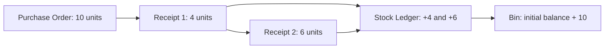

# ERPNext Enterprise QA Automation

Python, Pytest and Playwright portfolio project covering procurement workflows in
ERPNext v16.53.0 / Frappe v16.55.1. The local demonstration company is **Atlas
Distribution Ltd (ADL)**. UI actions drive business operations; authenticated,
read-only REST queries independently verify persistence, order progress and stock.

The business risk is receiving the same goods twice, leaving incorrect outstanding
order quantities, or showing stock that does not reconcile with receipts. This suite
checks those relationships across the UI, persisted documents and voucher-linked
Stock Ledger Entries rather than treating a successful button click as proof.

The main business flow creates an order for 10 units, receives 4 and then 6, and
reconciles the cumulative movement with the real starting inventory:



The GitHub workflow validates **offline code and safeguards only**. It does not
provision ERPNext, access a developer's localhost, or certify the UI/E2E suite.
There are no deployment steps or unverified green badges. Hosted offline execution
and local ERPNext business execution are separate evidence scopes.

## Coverage and execution categories

| Category | Selection | Runtime requirements | Scope |
|---|---|---|---|
| Offline | `-m offline` | Python packages and Git only | Locale parsing, OS lock, selection guards, publication contracts; no credentials/browser/services/network |
| Browser diagnostics | `-m browser` | Chromium | Synthetic trace privacy test; no ERPNext or real credentials; requests are intercepted |
| Integration smoke | `-m "integration and smoke"` | Chromium and a provisioned ERPNext | QA-001 navigation; QA-002 PO form; QA-003 PR form |
| Integration negatives | `-m "integration and negative and not transactional"` | Chromium and ERPNext QA data | NEG-001 missing supplier, NEG-002 missing item, NEG-003 zero quantity; invalid Save attempts, no planned business-document persistence |
| Transactional | Individual path plus `--run-transactions` | Authorized local QA ERPNext | QA-008 PO Draft; QA-011 PO → PR4 + PR6 → stock; NEG-004 over-receipt rejection |

`integration` is derived from each test's actual `authenticated_page` fixture
dependency. `transactional` is additive, not a synonym for all integration. The
browser diagnostic is deliberately **not offline**. Offline tests reject credential
loading, network connections and browser launch; their fixture closure is checked
at collection. All categories are registered and strict marker checking is enabled.

## Install and run offline

Clone the public repository:

```text
git clone https://github.com/YudRemijo/erpnext-qa-automation.git
cd erpnext-qa-automation
```

Windows PowerShell:

```powershell
py -3.12 -m venv .venv
.\.venv\Scripts\python.exe -m pip install -r requirements-dev.txt -c constraints-dev.txt
.\.venv\Scripts\python.exe -m pip check
.\.venv\Scripts\python.exe scripts/check_project.py
.\.venv\Scripts\python.exe scripts/validate_workflow.py
.\.venv\Scripts\python.exe -m pytest -m offline -v
```

Linux/macOS:

```bash
python3.12 -m venv .venv
.venv/bin/python -m pip install -r requirements-dev.txt -c constraints-dev.txt
.venv/bin/python -m pip check
.venv/bin/python scripts/check_project.py
.venv/bin/python scripts/validate_workflow.py
.venv/bin/python -m pytest -m offline -v
```

No `.env`, Playwright browser installation, ERPNext, Docker, or application data is
needed for these commands. Playwright's **Python package** is installed as a project
dependency; that is separate from downloading a browser runtime. Python 3.12 is
required; the observed local interpreter is 3.12.10. Direct dependencies are Pytest
9.2.0, Playwright 1.64.1 and pytest-playwright 0.10.0. `constraints-dev.txt` records
resolved installed transitive versions. Wheels are not hash-locked. Installation
and the offline checks were verified on GitHub-hosted Linux and Windows runners;
see the [hosted execution record](docs/ci-cd.md#first-hosted-execution).

## Configure your own ERPNext for UI tests

Provision ERPNext separately; this project does not create or start it. A hosted
GitHub runner cannot reach your workstation's localhost. Do not expose it publicly
or add ERPNext secrets to this offline workflow.

Install Chromium only when running browser/UI tests:

```powershell
.\.venv\Scripts\python.exe -m playwright install chromium
```

On Linux, where browser tests are explicitly needed, use
`.venv/bin/python -m playwright install --with-deps chromium` after reviewing its
system dependency changes. The CI workflow does **not** execute this command.

Copy `.env.example` to `.env` locally and replace both username/password placeholders
using an editor. Do not put passwords in shell arguments or committed files. Process
environment variables take precedence over the optional local file:

| Variable | Meaning |
|---|---|
| `ERPNEXT_BASE_URL` | ERPNext origin, e.g. `http://localhost:8080` |
| `ERPNEXT_USERNAME` | Authorized user on your own QA site |
| `ERPNEXT_PASSWORD` | Local secret; never include it in reports |

The loader runs only when a test requests settings. Authentication creates a fresh
browser context, does not reuse a user's interactive browser session, and is never
traced or screenshotted. DEBUG/PWDEBUG must be disabled for authenticated runs.

Do not assume your ERPNext already has the following test prerequisites:

- Company **Atlas Distribution Ltd**, abbreviation **ADL**, base currency **USD**.
- Enabled supplier **QA Atlas Test Supplier**, not blocked/on hold.
- Enabled item **QA-ADL-TEST-001**, purchasable, stock-managed, UOM **Nos**, with
  appropriate warehouse/account configuration and no required batch/serial inspection.
- Active non-group warehouse **Stores - ADL** in ADL.
- Approved tax template **Brazil ICMS 19% - ADL**, one On Net Total row on
  **ICMS 19% - ADL**, rate **19%**. Tests never change taxes or currency to force PASS.
- Authorized user with document/read/report permissions appropriate to each case.
- For current negative oracles: zero PO quantities disabled, effective over-receipt
  tolerance below 10%, and no configured over-receipt bypass role.

These are a **demo data contract**, not a universal ERPNext fiscal policy. Provision
them in your own controlled environment after review; tests do not create masters.
The current QA-011 also checks four historical local documents for non-modification
(PO00001/00002 and PR00001/00002); see the explicit prerequisite in `docs/ci-cd.md`.
Do not run that test on a clean site expecting those records to exist automatically.

Run read-only smoke separately from invalid Save attempts:

```powershell
.\.venv\Scripts\python.exe -m pytest -m "integration and smoke" -v
.\.venv\Scripts\python.exe -m pytest -m "integration and negative and not transactional" -v --maxfail=1
.\.venv\Scripts\python.exe -m pytest -m browser -v
```

## Authorized transactional runs

Use a dedicated QA window with a reviewed recovery plan. The existing local backup
has not yet passed an independent restore rehearsal. Successful QA-011 repetitions
increase stock by 10; retained Drafts and submitted documents are not cleaned up.

Run **one explicitly authorized scenario**, not the entire suite with the opt-in:

```powershell
# Creates one new PO Draft.
.\.venv\Scripts\python.exe -m pytest tests/transactions/test_qa008_purchase_order_draft.py --run-transactions -v -s

# Creates/submits one PO and two PRs, incrementing stock by 10.
.\.venv\Scripts\python.exe -m pytest tests/transactions/test_qa011_partial_receipt_e2e.py --run-transactions -v -s

# Creates/submits a new PO and retains an over-receipt PR Draft after rejected Submit.
.\.venv\Scripts\python.exe -m pytest tests/negative/test_over_receipt.py --run-transactions -v -s --maxfail=1
```

Writes are currently restricted to the approved loopback origin. A different origin
requires an explicit, reviewed code/configuration change. Each run uses generated IDs
and a real starting Bin balance, not a presumed zero. Save/Submit are never blindly
retried after uncertainty. Inspect persisted IDs before authorizing another run.
The local OS lock serializes this project's write/negative attempts and fails closed
when unavailable; it does not lock out other hosts or human users.

## Architecture, evidence and limits

```text
.github/workflows/ci.yml     Offline-only Linux/Windows checks
config/                     Lazy settings, restricted diagnostics, OS lock
pages/                      Login/navigation and small procurement UI helpers
scripts/check_project.py    Syntax/configuration/publication-safety checks
tests/unit/                 Offline checks and a separately marked browser diagnostic
tests/smoke/                Read-only authenticated UI checks
tests/negative/             Invalid Save/Submit behavior, with UI/API evidence
tests/transactions/         Authorized Draft and complete procurement lifecycle
docs/                       Strategy, scenarios, observations and implementation guides
artifacts/                  Ignored local execution evidence
```

Pytest exit codes and summaries indicate execution success/failure; skipped tests
were not validated. HTTP errors, locator timeouts and business-oracle mismatches need
different triage. A successful offline workflow is not an ERPNext/E2E result.

Local manifests record policy, IDs and business checkpoints. Failed post-login runs
retain screenshots and actions/screens traces with DOM/network/source capture off.
Header clearing and synthetic-secret tests protect the current cookie-based context;
re-review diagnostics before adding header authentication or saved storage state.
Artifacts, `.env`, backups, dumps, keys and private recovery configs are excluded
from publication. No real site configuration or local infrastructure template is
published; the retired, unvalidated local `infra/` proposal is ignored
and is not used by tests or CI.

Documentation:

- [CI scope, audit and validation](docs/ci-cd.md)
- [Evidence index and verification limits](docs/evidence.md)
- [Final pre-commit audit](docs/release-audit.md)
- [Transactional implementation and observed results](docs/transactional-automation.md)
- [Negative cases and UI/backend evidence](docs/negative-test-automation.md)
- [Test strategy](docs/test-strategy.md), [scenario catalogue](docs/test-scenarios.md),
  [original exploratory findings](docs/exploratory-findings.md)

Historical documents retain local observations; personal absolute paths were
redacted and runtime code uses repository-relative paths. The public repository is
[YudRemijo/erpnext-qa-automation](https://github.com/YudRemijo/erpnext-qa-automation);
actual hosted runs are visible in [Actions](https://github.com/YudRemijo/erpnext-qa-automation/actions).
No deployment or validated restore is claimed.

## Licensing and attribution

Licensed under the [MIT License](LICENSE). Copyright (c) 2026 Yud Remijo.
See [third-party notices](THIRD_PARTY_NOTICES.md)
for dependency attribution and the distinction between dependencies and vendored code.
